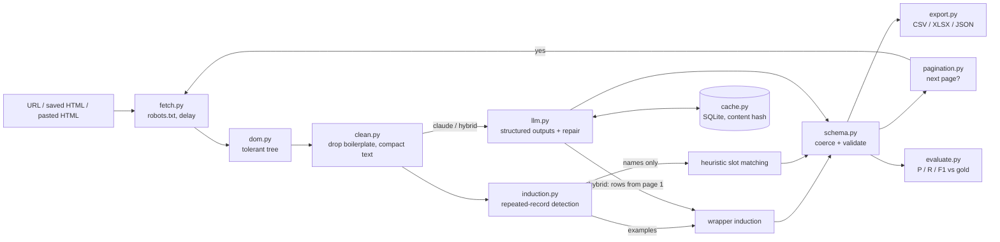

# ai-scraper: evaluated structured extraction from web pages


You name the columns you want, such as `title, price in GBP, star rating (1-5), in stock (yes/no)`, and optionally type one or two example rows. ai-scraper returns a typed, validated table from a listing page, follows next-page links, and exports CSV, Excel or JSON.

Four extractors share one pipeline:

| Extractor | Needs | How it works |
|---|---|---|
| **heuristic** | column names only | Finds the repeated record block on the page and matches fields to slots using names, types and labels. Offline. |
| **induction** | + 1-2 example rows | Wrapper induction: learns an exact rule per field (path, attribute, n-th number, label prefix) from your examples, then applies it to every record and every page. Offline and deterministic. |
| **claude** | column names + API key | Sends the cleaned page to Claude with a JSON schema (structured outputs), then validates, coerces and repairs the rows. |
| **hybrid** | column names + API key | Claude reads page 1. A wrapper is learned from Claude's rows and verified against them (F1 at least 0.9), and later pages run on that wrapper with no API calls. |

Every extractor is scored. 14 saved page sets come with 264 hand-checked rows, and each extractor gets field-level precision, recall and F1. Four of the sets were **held out**: they were written after the extractors were tuned, and their scores are reported separately.

> Crawling a whole site is a different job, handled by the sibling project web-scraper. This project turns one page, or a short paginated list, into a correct table.

## Features

**Page cleaning and chunking** (`ai_scraper/dom.py`, `ai_scraper/clean.py`)
- A tolerant HTML tree builder (no BeautifulSoup) that gives every node a stable id, so detected records can be outlined in the preview.
- Drops scripts, styles, navigation, footers, cookie and newsletter banners, ads and share widgets. Pages become compact text: links as `[text](url)`, tables as `a | b | c`, and values hidden in attributes (`title`, `datetime`, rating classes) are kept.
- On the 19 saved pages this cuts raw HTML from 40,012 to 17,539 estimated tokens (-56%) before anything is sent to Claude.
- Long pages are split on record boundaries into chunks under a token budget. A chunk that hits `max_tokens` is split again instead of being cut off.

**Record detection and wrapper induction** (`ai_scraper/induction.py`)
- Finds the repeated sibling structure that holds the records: cards, list items, table rows, and records that span several elements, like Hacker News's two-row items.
- With example rows, it searches the candidate slots for the rule that reproduces your values. Rules can read:
  - text or an attribute;
  - the n-th number in a string (`"3 bd · 2 ba"`);
  - a label prefix (`"Location: Berlin"`);
  - a joined list of tags;
  - a resolved URL.

  The UI shows the learned rules under *Learned rules*.
- Without examples, it scores slots by type fit, name hints, column headers, labels and variety. A price column prefers values next to a currency sign.

**Claude structured outputs** (`ai_scraper/llm.py`)
- Uses `output_config.format` with a JSON schema built from your columns, and `effort: low`. The system prompt and schema use prompt caching: the real run wrote 11,165 cache tokens and read 3,943.
- Each row is coerced to its type: `"£1,299.50"` becomes `1299.5` and `"In stock"` becomes `true`.
- If rows break the schema, one repair turn is sent listing the specific problems.
- A `refusal` stops with a clear error, and a `max_tokens` stop splits the chunk.
- The model comes from `CLAUDE_MODEL` (default `claude-opus-5-5`). Server-side fallback is turned on for models that support it.

**Cache and cost accounting** (`ai_scraper/cache.py`)
- A SQLite response cache keyed by a content hash of the model, schema, prompt and page text. Re-running a job over unchanged pages costs nothing, and a changed page is a miss.
- Every job reports requests, input, output and cache tokens, the cost in USD, and the spend that cache hits avoided. The CLI prints this and the UI shows it as *API cost*.

**Pagination and fetching** (`ai_scraper/pagination.py`, `ai_scraper/fetch.py`)
- Finds the next page from:
  - `rel=next`;
  - links whose text or aria-label says "next", or that are arrows;
  - elements whose class says "next";
  - a numbered pager (current page + 1).

  It ignores links to other hosts and stops on loops and at a page cap.
- The fetcher obeys robots.txt, waits between requests to the same host, refuses URLs that are not http(s), and sends an honest user agent.

**Evaluation** (`ai_scraper/evaluate.py`, `fixtures/`)
- Predicted rows are matched one-to-one to gold rows. Each non-empty cell counts as a true positive, false positive or false negative, giving micro and per-field P/R/F1.
- Comparison is type-aware:
  - numbers must agree to 1e-6;
  - URLs are compared without a trailing slash;
  - text ignores case, whitespace, wrapping quotation marks and the spacing after list commas.
- The 1-2 example rows are left out of scoring for every extractor, so induction is never graded on rows it was given.

**Web UI and API** (`ai_scraper/web/`)
- The *Extraction studio* has four steps: page, columns, example rows and extractor.
  - Results tabs: the table, the page with every detected record outlined, the learned rules, and a per-page log.
  - Rows export to CSV, Excel and JSON.
- The *Evaluation* page shows every offline extractor on every saved page, split into dev and held-out, with per-field scores.
- The UI is vanilla JS with no build step, a light and dark theme, and a strict CSP. The record preview renders in a sandboxed iframe with its own `default-src 'none'` policy, so a scraped page can neither run scripts nor load anything.

**Export** (`ai_scraper/export.py`)
- CSV is UTF-8 with a BOM so Excel opens it correctly. Cells that start with `= + - @` are escaped against formula injection.
- Excel gets typed numbers with number formats, clickable links, a frozen header and fitted column widths.
- JSON keeps the types and the column order.

## Architecture



`pipeline.Scraper` ties these together. Fetching and the Claude client are injected, so the 83 tests run with no network and a fake Claude client.

## Quickstart

```bash
pip install -r requirements.txt
cp .env.example .env            # optional: add ANTHROPIC_API_KEY for the claude and hybrid modes
python -m ai_scraper serve      # http://127.0.0.1:5000
```

Docker (port 8000, non-root user, read-only filesystem, healthcheck):

```bash
docker compose up --build
```

Without an API key everything works except the claude and hybrid modes. The web server only extracts from the saved sample pages and from pasted HTML, unless `AISCRAPER_ALLOW_FETCH=1` is set (see Limitations).

### Command line

```bash
# a live listing, up to 3 pages, learned from two example rows, Excel out
python -m ai_scraper extract https://books.toscrape.com/ \
    --request "title, price in GBP, star rating (1-5), in stock (yes/no)" \
    --examples my_two_rows.json --pages 3 -o books.xlsx

# a saved page with Claude
python -m ai_scraper extract --file page.html --request "name, date, venue, price" --mode claude -o events.csv

# score the offline extractors on the saved pages
python -m ai_scraper eval
```

The per-page log, notes and Claude usage go to stderr, and the rows go to the output file (JSON to stdout by default).

Example outputs made from the saved pages:
- [`examples/books.xlsx`](examples/books.xlsx)
- [`examples/quotes.csv`](examples/quotes.csv)
- [`examples/real_estate.json`](examples/real_estate.json)

## API

| Method | Path | Body / result |
|---|---|---|
| GET | `/health` | `status`, `version`, `fixtures`, `uptime_seconds`, `claude`, `fetch` |
| GET | `/api/fixtures` | The saved page sets with schema, example rows and split |
| POST | `/api/schema` | Body `{request, use_claude?}`. Returns columns with types, from rules or from Claude. |
| POST | `/api/extract` | Body: `{mode, pages, schema or request, examples?}` plus one of `fixture`, `html` (+`base_url`) or `url`. Returns the rows, a per-page log, the learned rules, usage and the preview HTML. For saved pages it also returns the score against gold. |
| GET | `/api/eval` | Every offline extractor on every saved page, plus summaries |
| POST | `/api/export` | Body `{format: csv/xlsx/json, rows, schema or request, filename}`. Returns a file. |

Errors are JSON with an `error` field. The API validates:
- the mode;
- the page count (1-10);
- schema field names;
- the number of examples;
- the HTML size (2 MB);
- the export format.

URLs are refused with 403 unless fetching is turned on. When it is, private, loopback and link-local addresses are refused on every hop, next-page links included.

## Measured results

Produced by:
- `python scripts/benchmark.py`: offline extractors, median of 5 runs;
- `python scripts/benchmark.py --claude`: one real API run with a hard $0.80 budget.

Raw data: [`examples/benchmark.json`](examples/benchmark.json).

<!-- bench:start -->
Measured 2026-11-20 on Windows 11 (AMD64), Python 3.12.3. 14 saved page sets (19 pages, 264 hand-checked rows); the 2 example rows of each set are excluded from scoring for every extractor.

**Field-level accuracy (micro-averaged over all cells)**

| Extractor | Needs | Dev F1 (10 sets, used for tuning) | Held-out F1 (4 sets) | All: P / R / F1 | Pages/s |
|---|---|---|---|---|---|
| heuristic | column names only | 0.962 | 0.887 | 0.941 / 0.955 / **0.948** | 54.8 |
| induction-1 | + 1 example row | 0.979 | 0.937 | 0.970 / 0.972 / **0.971** | 49.7 |
| induction-2 | + 2 example rows | 1.000 | 0.937 | 0.989 / 0.989 / **0.989** | 37.8 |
| claude (claude-opus-5-5) | column names + API | 0.994 | 1.000 | 0.991 / 1.000 / **0.995** | 19 Claude calls for 19 pages, $0.440 |
| hybrid (claude-opus-5-5) | column names + API | 0.997 | 1.000 | 0.994 / 1.000 / **0.997** | 15 Claude calls for 19 pages, $0.345 |

**Per page set (F1)**

| Set | Split | Pages | heuristic | induction-1 | induction-2 | claude | hybrid |
|---|---|---|---|---|---|---|---|
| books | dev | 3 | 1.000 | 1.000 | 1.000 | 1.000 | 1.000 |
| countries | dev | 1 | 1.000 | 1.000 | 1.000 | 1.000 | 1.000 |
| events | dev | 1 | 1.000 | 1.000 | 1.000 | 0.961 | 0.961 |
| hn | dev | 2 | 0.772 | 1.000 | 1.000 | 1.000 | 1.000 |
| jobs | dev | 1 | 1.000 | 1.000 | 1.000 | 1.000 | 1.000 |
| products | dev | 2 | 1.000 | 1.000 | 1.000 | 0.955 | 0.980 |
| quotes | dev | 2 | 1.000 | 0.667 | 1.000 | 1.000 | 1.000 |
| real_estate | dev | 1 | 1.000 | 1.000 | 1.000 | 1.000 | 1.000 |
| repos | dev | 1 | 1.000 | 1.000 | 1.000 | 1.000 | 1.000 |
| restaurants | dev | 1 | 1.000 | 1.000 | 1.000 | 1.000 | 1.000 |
| holdout_blog | holdout | 1 | 1.000 | 1.000 | 1.000 | 1.000 | 1.000 |
| holdout_forum | holdout | 1 | 0.828 | 0.800 | 0.800 | 1.000 | 1.000 |
| holdout_specs | holdout | 1 | 0.700 | 1.000 | 1.000 | 1.000 | 1.000 |
| holdout_wiki | holdout | 1 | 1.000 | 1.000 | 1.000 | 1.000 | 1.000 |

**What Claude would be sent (estimated tokens, offline estimator)**

Raw HTML 40,012 -> cleaned page text 17,597 (-56.0%) -> blocks actually sent, boilerplate dropped 17,539 (-56.2%) over 19 pages.

**Response cache (stub client, no network):** first pass 19 API calls, second pass over the same pages 0.

**Real API run (2026-11-20, claude-opus-5-5):** Claude mode 19 calls, 30,363 input + 13,078 output tokens, $0.4396. Hybrid needed 15 Claude responses for the same 19 pages (one per set, plus one where the learned wrapper failed verification; the rest ran on the wrapper); in this run they were served from the Claude run's cache, so it cost $0.0000 instead of $0.3455. Re-running Claude mode: 0 calls, 19 cache hits, $0.0000 ($0.4396 not spent). Total spent: $0.4396. Scores re-computed from the cached responses on 2026-11-20.

Where Claude loses points it writes 0 for a value the page states as "Free" or "No reviews yet"; the hand-checked rows use null there. That is a labelling convention, and the gold rows were left as they are.

<!-- bench:end -->

### How to read these numbers

- **The held-out column is the honest one.** The 10 dev sets were used while building the extractors, so induction-2's perfect dev score is optimistic.
  - On the 4 held-out sets, induction scores 0.937. All of the loss is the forum's `pinned` column. Both example rows are pinned topics, so the learned rule never sees a `false` and marks every row pinned. Example rows should cover both values of a yes/no column; the UI and the CLI do not warn about this yet.
  - One general fix (records may carry an extra class) was made after first seeing the held-out pages. It is the only change made after that point, and both this README and the UI say so.
- **Claude's misses come from a labelling convention.** On `events` and `products`, Claude writes `0` for "Free" and "No reviews yet", while the hand-checked rows say `null`. The gold rows were not changed to suit the model.
- **The scorer was changed once, after the Claude run.**
  - The first scoring gave Claude 0.684 on `quotes`, because it dropped the decorative “ ” around the quotes and wrote `a,b` for `a, b` in tags.
  - Text comparison now ignores wrapping quotation marks and list-comma spacing, for every extractor. The offline scores did not change.
  - The scores were recomputed from the cached responses (`--rescore`, no new API calls), so the cost figures come from the one real run.
- **Hybrid** needed 15 Claude responses for the 19 pages, where Claude mode needed 19. The saving grows with the number of pages per set, and these sets have 1-3 pages.
- Pages/s depends on the machine. These figures were measured on a laptop.

## Design decisions

- **Examples before prompts.** Most scraping jobs are one layout across many pages. Two typed rows let the tool learn exact rules once and then run offline, deterministically and for free. Claude is for pages where you cannot or will not give examples, and hybrid uses Claude only to bootstrap the rules.
- **Evaluate everything, hold some out.** A scraper that looks right on three rows proves little. Every extractor is scored on the same cells, the example rows are left out, and the pages written after tuning are reported separately.
- **Validate model output like user input.** Structured outputs guarantee the shape of the JSON, not the values in it. Rows are coerced and checked against the schema and one repair turn is allowed. Anything still invalid is reported, never dropped silently.
- **Make cost visible.** Every run reports tokens and dollars, and the content-hash cache makes a re-run free. The benchmark has a hard budget and re-scores from cached answers.
- **Own tree builder.** Record detection needs stable node ids, attribute access, and a serializer that can outline records. A small tolerant parser was simpler than adapting BeautifulSoup. Runtime dependencies are Flask, anthropic, requests, openpyxl and python-dotenv.

## Project layout

```
ai_scraper/
  dom.py           tolerant HTML tree, serializer
  clean.py         boilerplate removal, compact text, token estimate, chunking
  schema.py        columns from plain text, JSON schema, coercion, validation
  induction.py     record detection, wrapper induction, heuristic matching
  pagination.py    next-page detection
  fetch.py         polite fetcher (robots.txt, delay), DictFetcher for tests
  llm.py           Claude structured outputs, repair, chunk splitting
  cache.py         SQLite response cache, usage and cost
  pipeline.py      Scraper: modes, pages, preview
  evaluate.py      fixtures, alignment, P/R/F1
  export.py        CSV / XLSX / JSON
  web/             Flask app + static UI (extraction studio, evaluation)
  __main__.py      CLI: extract | eval | serve
fixtures/          14 page sets: page*.html, spec.json (columns, examples), gold.json
scripts/
  benchmark.py     offline + optional Claude benchmark, writes examples/benchmark.*
  make_fixtures.py generates the synthetic page sets
tests/             83 pytest tests, no network, Claude mocked
```

## Limitations

- **The saved pages are synthetic.** `scripts/make_fixtures.py` generates them to imitate common layouts: a book shop, Hacker News, a product grid, a wiki table, a forum and a spec sheet. They are not copies of real sites. The scores compare the methods; they do not measure accuracy on any particular site.
- **No JavaScript rendering.** For pages that build their content in the browser, save the page after it renders, or paste its HTML.
- **Server-side fetching is off by default**, because a public server that fetches any URL is an SSRF risk.
  - `AISCRAPER_ALLOW_FETCH=1` turns it on, for a local single-user install.
  - With it on, URLs are resolved and private addresses refused.
  - DNS rebinding between that check and the request is not prevented.
- Detection assumes a page of repeated records. A single article page works only in Claude mode.
- Only the 4 held-out sets are truly unseen, which is a small sample.
- Docker files and CI are included, but the image has not been built on the development machine, which has no Docker. CI builds it and checks `/health` and an extract call.

## License

MIT
