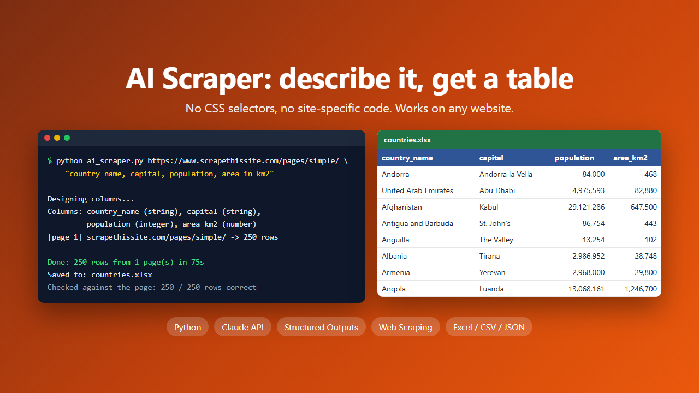

# AI Scraper

Extract structured data from **any website** by describing what you want in plain language. No CSS selectors and no site-specific code.



```bash
python ai_scraper.py https://books.toscrape.com "book title, price in GBP, star rating (1-5), in stock (yes/no)" --pages 2
```

```
Designing columns...
Columns: title (string), price_gbp (number), star_rating (integer), in_stock (boolean)
[page 1] https://books.toscrape.com -> 20 rows
[page 2] https://books.toscrape.com/catalogue/page-2.html -> 20 rows

Done: 40 rows from 2 page(s) in 33s
Saved to: results.xlsx
```

## Why an AI scraper?

Classic scrapers break whenever a website changes its HTML, and every new site needs new code. This one reads the page the way a person does:

- **You describe the data**, and Claude designs typed columns (text, number, integer, yes/no)
- **Structured Outputs**: every answer is validated against a JSON schema, so the table is always clean and consistent
- **Follows pagination** automatically (`--pages 5`)
- **Never invents data**: missing values become empty cells
- **Cleans numbers**: `£51.77` becomes `51.77`, `1,246,700` becomes `1246700`
- **Removes duplicates** across pages
- **Respects robots.txt**, waits between pages and stays on the same website
- **Exports to Excel, CSV or JSON**. The Excel file has a styled header, filters and a "Columns" sheet that explains how each value was read.

## Tested accuracy

Checked against the real pages, cell by cell:

| Site | Request | Rows | Correct |
|---|---|---|---|
| books.toscrape.com (2 pages) | title, price, rating, in stock | 40 | **40 / 40** |
| scrapethissite.com countries | country, capital, population, area | 250 | **250 / 250** |
| quotes.toscrape.com | quote, author, tags | 10 | 10 / 10 (tags joined without spaces after commas) |

Example outputs are in [`examples/`](examples/).

## How it works

1. **Fetch and clean.** The page is downloaded and turned into compact text. Scripts and styles are removed, links and images keep their URLs, table rows are kept as `a | b | c`, and data hidden in class names (like star ratings) is kept.
2. **Design columns.** Claude reads your request and the start of the page and returns typed fields, using a strict JSON schema.
3. **Extract.** For each page (split into chunks if it's long), Claude returns all matching items plus the "next page" link, validated against a schema built from the columns.
4. **Merge and save.** Rows are de-duplicated and written to Excel, CSV or JSON.

## Setup

```bash
pip install -r requirements.txt
cp .env.example .env    # Windows: copy .env.example .env
# add your API key from https://console.anthropic.com to .env
```

## Usage

```bash
python ai_scraper.py URL "what to extract" [--pages N] [-o output.xlsx|.csv|.json]

python ai_scraper.py https://quotes.toscrape.com "quote text, author, tags" -o quotes.csv
python ai_scraper.py https://www.scrapethissite.com/pages/simple/ "country name, capital, population, area in km2"
```

## Cost

The scraper prints the tokens it used after each run. In the tests above:

- 2 book pages (40 rows): about $0.12
- 250 countries: about $0.26

These costs are with the default model `claude-opus-5-5`. Set `CLAUDE_MODEL=claude-sonnet-5-5` in `.env` for about half the price.

## Limits

- Pages that load their content with JavaScript after the page opens aren't supported. The scraper stops with a clear message if a page has almost no text.
- Only scrape data you're allowed to use. Check the website's terms, and don't collect personal data without a legal basis.

## Tests

```bash
python -m unittest discover tests
```

11 offline tests with a fake AI client and fake web pages: page cleaning, chunking, pagination, de-duplication, robots.txt, the JSON schema, and Excel/CSV/JSON export.
